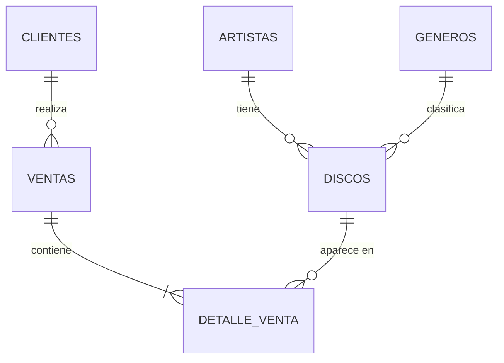

# Proyecto Tienda de discos: base de datos y consultas SQL
## Descripción
Base de datos de una tienda de discos, hecha con SQLite y Python. En ella practico el diseño de tablas relacionadas y las consultas con `JOIN` ,`GROUP BY`, `HAVING` y `LEFT JOIN`. 
## Esquema
La base de datos tiene 6 tablas:

| Tabla | Qué guarda |
|---|---|
|`artistas` | El nombre y el país de origen de cada artista |
|`generos` | Los géneros musicales (Rock, Pop, Jazz) |
|`discos` | Título, año, precio y stock de cada disco, y a qué artista y género pertenece
|
|`clientes` | Nombre, email, ciudad y fecha de alta de cada cliente |
|`ventas` | Cada compra: qué cliente la hizo y en qué fecha |
|`detalle_venta` | Los discos de cada compra, con la cantidad y el precio en el momento de la venta |



## Cómo ejecutarlo 

Solo hace falta Python 3 (el módulo `sqlite3` ya viene incluido).

```
git clone https://github.com/rochabernardo393-sys/tienda-discos-sql.git
cd tienda-discos-sql
python ejecutar.py
```

El script crea la base de datos `tienda_discos.db`, ejecuta las 9 consultas y muestra los resultados por pantalla.

## Consultas

| # | Qué responde | Técnica |
|---|---|---|
| 1 | Todos los discos, del más barato al más caro | `SELECT`, `ORDER BY` |
| 2 | Discos posteriores a 1980 que cuestan menos de 22 | `WHERE` con `AND` |
| 3 | Cada artista con su disco y su género | `JOIN` de 3 tablas |
| 4 | Resumen por género: discos, precio medio y stock | `GROUP BY`, `COUNT`, `AVG`, `SUM`|
| 5 | Artistas con más de un disco  | `GROUP BY` con `HAVING` |
| 6 | Cuánto ha gastado cada cliente | `JOIN` de tres tablas y `SUM` |
| 7 | Discos que nunca se han vendido | `LEFT JOIN ` con `IS NULL` |
| 8 | Ingresos y número de ventas de cada mes | `strftime` y `GROUP BY` | 
| 9 | Clientes que todavía no han comprado nada | `LEFT JOIN` con `IS NULL` |

## Decisiones de diseño

- **Artistas y géneros en tablas aparte.** Así no se repite el texto en cada disco, y si hay que cambiar un nombre se hace en un solo sitio.
- **`detalle_venta` guarda el `precio_unitario`.** Es el precio en el momento de la compra:
si el precio de un disco cambia mañana, las ventas antiguas no se alteran.
- **Una venta puede tener varios discos.** Por eso hay dos tablas: `ventas` (la compra) y `detalle_venta` (los discos de cada compra).
- **Restricciones en el propio esquema.** Claves ajenas (`REFERENCES`), `UNIQUE`  en el email y `CHECK` para que el precio sea mayor que cero y el stock no sea negativo.

## Límites

- Los títulos, artistas y años son reales, pero los precios, el stock, los clientes y las ventas son inventados.
- Es una muestra pequeña (8 discos y 6 ventas): sirve para practicar SQL, no para sacar conclusiones de un negocio.
- El stock no baja automaticamente al hacer una venta.
- SQLite no tiene tipo fecha, así que las fechas se guardan como texto con formato `AAAA-MM-DD`. 